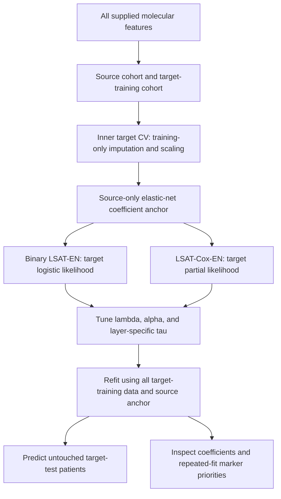
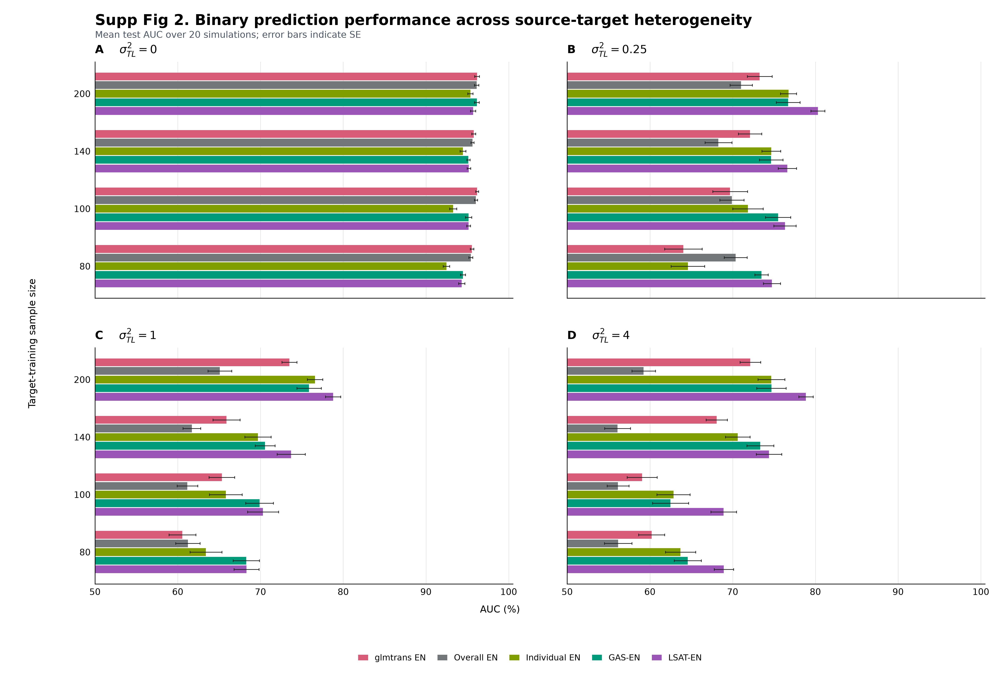

# LSAT-EN

### Layered Source-Anchored Transfer Elastic Net

**Binary and censored survival prediction with layer-specific borrowing,
elastic-net regularization, and interpretable coefficients.**

LSAT-EN fits a source-only elastic-net anchor, then fits the target-cohort
likelihood with a separate borrowing weight for each omics layer. It supports
binary logistic and Cox proportional-hazards outcomes, target-training
cross-validation, pooled and target-only EN baselines, and repeated-fit
biomarker prioritization.

**The package uses all features you supply. There is no separate screening,
SIS, top-K, or feature-budget selection step.** Elastic net can assign zero
coefficients during model fitting; this is distinct from prescreening inputs.
The API is not limited to breast cancer, six layers, or age-defined cohorts.

[Installation](#installation) | [Binary](#1-binary-prediction) |
[Cox](#2-cox-survival-prediction) | [Inputs and outputs](#inputs-and-outputs) |
[Tutorial](docs/tutorial.md) | [API](docs/api.md) | [Methods](docs/methods.md) |
[Study background](docs/background.md)

## Workflow



No held-out target test patients participate in `fit()`. Within inner CV,
validation patients are excluded from preprocessing and source-anchor
construction. See the [mathematical specification](docs/methods.md).

## Installation

Python 3.10+ is required. Install directly from GitHub:

```bash
python -m pip install "lsat-en[survival] @ git+https://github.com/wguo3773/LSAT-EN.git"
```

The `survival` extra supplies scikit-survival's C-index and IPCW AUC metrics.
Binary/Cox fitting itself requires NumPy, SciPy, pandas and scikit-learn.
Alternatively, clone and install locally:

```bash
git clone https://github.com/wguo3773/LSAT-EN.git
cd LSAT-EN
python -m pip install -e ".[dev,survival]"
python -m pytest -q
python examples/quickstart.py
```

The package is distributed here as Python source and wheel artifacts, not
claimed to be published on PyPI. Runtime grows with feature count and search
size; all-feature input does not imply that an exhaustive six-layer tau grid
will be inexpensive. Dense input matrices are currently required.

## 1. Binary Prediction

```python
from lsaten import LSATBinaryCV, make_binary_transfer, binary_metrics

data = make_binary_transfer(
    n_source=180, n_target=90, n_test=150,
    n_features=36, block_size=6, sigma2_tl=0.25, random_state=42,
)
model = LSATBinaryCV(
    lambdas=(0.02, 0.1), alphas=(0.5,), tau_grid=(0.0, 0.5, 2.0),
    cv=3, coordinate_passes=1,
)
model.fit(
    data["X_source"], data["y_source"],
    data["X_target"], data["y_target"], groups=data["groups"],
)
probability = model.predict_proba(data["X_test"])[:, 1]
print(binary_metrics(data["y_test"], probability))
print(model.best_params_)
print(model.feature_table().head())
```

All 36 predictors are retained as model inputs. `groups` assigns one layer
label to every feature. Real datasets can use labels such as `mRNA`, `miRNA`,
`methylation`, `CNV`, `protein`, and `mutation`.

`predict_proba(X)[:,1]` always predicts **label 1**. For fixed-horizon
survival, encode 1 as survival through the horizon and 0 as death by it.
Patients censored before that horizon must be excluded from binary fitting;
[`binary_at_horizon()`](docs/api.md) provides this conversion.

## 2. Cox Survival Prediction

```python
from lsaten import LSATCoxCV, make_survival_transfer, survival_metrics

data = make_survival_transfer(
    n_source=140, n_target=90, n_test=100,
    n_features=36, block_size=6, random_state=43,
)
model = LSATCoxCV(
    lambdas=(0.05, 0.15), alphas=(0.5,), tau_grid=(0.0, 0.5),
    cv=3, coordinate_passes=1,
)
model.fit(
    data["X_source"], data["y_source"],
    data["X_target"], data["y_target"], groups=data["groups"],
)
risk = model.predict(data["X_test"])  # higher = higher event risk
print(survival_metrics(
    data["y_target"], data["y_test"], risk,
    times=(2.0, 3.0, 4.0, 5.0), on_error="nan",
))
survival_probability = model.predict_survival_function(
    data["X_test"], times=[2.0, 3.0, 4.0, 5.0],
)
```

Synthetic follow-up is in **years**. For actual data measured in days, use
matching day-valued evaluation times. `survival_outcome(time,event)` creates
the required structured labels, with event=1 for an observed death/event.
Target-training outcomes estimate the baseline hazard and censoring weights.
Unsupported IPCW evaluations raise by default, or return NaN **with the
reason** when `on_error="nan"`; missing AUC is never replaced with zero.

## Inputs and Outputs

| Input | Meaning |
|---|---|
| `X_source`, `X_target` | Numeric matrices or matching DataFrames; rows are patients, columns are all supplied features |
| `y_source`, `y_target` | Binary 0/1, or structured event/time outcomes |
| `groups` | One layer label per feature, in column order |
| `feature_names` | Optional unique feature names; inferred from DataFrame columns |
| `lambdas`, `alphas` | Candidate elastic-net strengths and L1 fractions |
| `tau_grid` | Candidate layer weights, shared sequence or layer-to-sequence dictionary |
| `source_lam`, `source_alpha` | Fixed source-anchor regularization settings |
| `cv`, `random_state` | Target inner folds and fold reproducibility |

| Output | Meaning |
|---|---|
| `best_params_` | Selected lambda, alpha and layer-specific tau values |
| `cv_results_` | Tried settings, fold losses, mean validation loss and convergence |
| `feature_table()` | Every input feature, layer, nonzero flag, raw/standardized coefficient, source anchor and tau |
| `n_features_in_`, `n_nonzero_` | Number supplied and number with absolute standardized coefficient >1e-6 |
| `coef_`, `coef_standardized_` | Coefficients in input and standardized units |
| `predict_proba()` | Binary class probabilities |
| `predict()` | Binary class or Cox relative log hazard |
| `predict_survival_function()` | Cox survival probabilities, patients x requested times |
| `converged_` | Source/target optimizer convergence status |

**Default CV settings:** lambdas=(0.01,0.1), alphas=(0.5,),
tau_grid=(0,0.1,1), cv=5, source_lam=0.05, source_alpha=0.5.
The default coordinate tau search is practical but not a guaranteed global
grid optimum. Set `tau_search="grid"` for an exhaustive Cartesian search
when feasible. Nonconverged candidates cannot win CV. Use fixed-parameter
`LSATBinary` / `LSATCox` when tuning is not needed. [Full API](docs/api.md)

## 3. Fair Comparisons and Repeated Target Splits

```python
overall = LSATBinaryCV(strategy="pooled", cv=3)
individual = LSATBinaryCV(strategy="target", cv=3)
```

Fit each method on the same source/target-training inputs and use identical
outer test patients. Each baseline can select its own lambda and alpha from
the same grids using target validation folds. The target-only strategy also
uses target-only preprocessing. No feature screening occurs in any strategy.

[`examples/repeated_target_splits.py`](examples/repeated_target_splits.py)
shows 10 matched 70/30 outer target splits with inner CV. Do not choose
parameters or report only the most favorable outer split. Repeated splits
share patients: their SD describes split variability, not independent-cohort
uncertainty. Source/target definitions, end points and time units are user inputs.

## 4. Biomarker Prioritization

```python
from lsaten import stable_features, priority_overlap

# repeated_models: independently refitted models with the same input columns
stability = stable_features(
    repeated_models, min_frequency=0.8, min_sign_consistency=0.8,
)
top_markers = stability.query("stable").head(50)
# compare = priority_overlap({"LSAT": stability, "Overall": overall_stability})
```

Priority is absolute median nonzero standardized coefficient x selection
frequency. Positive binary coefficients increase model-predicted odds of
label 1; positive Cox coefficients increase event hazard, conditional on
other predictors. Priority-list absence is not necessarily a zero coefficient.
Markers remain candidates, not validated mechanisms or treatment predictors.
The package does not bundle miRDB data, infer regulatory interactions from
coefficient signs, or automatically establish pathway enrichment.

## Example Outputs

These are **actual synthetic-data results** from
[`examples/quickstart.py`](examples/quickstart.py), using all 36 predictors
in each method. They illustrate outputs, not expected superiority in every
dataset and not a reproduction of the manuscript tables.

| Binary method | Test AUC | Test log loss | Nonzero coefficients |
|---|---:|---:|---:|
| LSAT-EN | 0.9287 | 0.3381 | 33 |
| Overall EN | 0.9177 | 0.3639 | 25 |
| Individual EN | 0.9408 | 0.3182 | 30 |

| Cox method | C-index | 2-year AUC | 3-year AUC | 4-year AUC | 5-year AUC |
|---|---:|---:|---:|---:|---:|
| LSAT-Cox-EN | 0.9033 | 0.9697 | 0.9636 | 0.9699 | 0.9749 |
| Overall Cox-EN | 0.9033 | 0.9577 | 0.9491 | 0.9657 | 0.9715 |
| Individual Cox-EN | 0.9048 | 0.9711 | 0.9660 | 0.9722 | 0.9782 |

[Binary metrics CSV](docs/example-output/binary-metrics.csv) |
[Cox metrics CSV](docs/example-output/cox-metrics.csv) |
[Binary coefficients](docs/example-output/binary-features.csv) |
[Cox coefficients](docs/example-output/cox-features.csv) |
[Selected binary parameters](docs/example-output/binary-best-parameters.json).

## Study Background

Younger breast cancer patients may have distinct tumor biology and fewer
available outcomes for model development. LSAT-EN was developed to borrow
information from older source cohorts while adapting associations within
each omics layer. The manuscript studies age >=60, >=55 and >=50 source
cohorts and a <50 target cohort, with binary and censored survival outcomes.
Its reported simulations and TCGA-BRCA results, including the numerical
summary supplied by the authors, are available in the [study background](docs/background.md).



This supplied manuscript figure is distinct from the synthetic package
examples above. Historical screened-panel analyses and the new all-feature
Python package should not be described as identical pipelines.

## Documentation and Validation

- [Tutorial: real input layouts, fitting and prediction](docs/tutorial.md).
- [API reference](docs/api.md) and [objective/CV specification](docs/methods.md).
- [Validation summary](docs/validation.md) and [test suite](tests/test_lsaten.py).
- [Contributing](CONTRIBUTING.md), [license](LICENSE), [citation metadata](CITATION.cff).
- [scikit-survival IPCW AUC](https://scikit-survival.readthedocs.io/en/stable/api/generated/sksurv.metrics.cumulative_dynamic_auc.html).

The package checks analytic gradients, limiting cases, fold-local preprocessing
and predictor retention. Its unanchored ridge cases are compared against
scikit-learn logistic regression and scikit-survival Cox regression.
Clinical use requires independent validation and appropriate study oversight.

## Citation and Contact

Wanru Guo, Binbin Wang, and Curtis Tatsuoka. *LSAT-EN: Layered Source-Anchored
Transfer Elastic Net*. Python software, version 0.1.0 (2026).
Manuscript DOI will be added when available; no publication identifier is invented.
Contact: wanru.guo@som.umaryland.edu.

Repository organization takes inspiration from [UniST](https://github.com/lanshui98/UniST).
No UniST model implementation is used; LSAT-EN is a separate statistical method.

